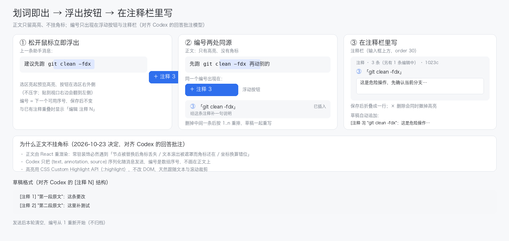

# 功能案：会话对话注释（components/annotations）

> 状态：已实现（入口 `live-entry-76.js`，2026-10-23 接回；组件代码 2026-10-22 完成）
> 关联组件：`components/annotations/`（新建）、`components/toolkit/`（壳内置分页）、`components/clipboard/`（同一套 DOM 注入做法）
> 面板位置：会话内浮层（`shell.overlay`，划词浮动按钮）+ 输入框上方注释栏（`conversation.input.dock`）+ toolkit 分页「注释」
> 前置阅读：`docs/功能案-工具集壳.md`、`docs/功能案-剪贴板.md`
> 参考：① OpenAI Codex app 的 inline comments（https://developers.openai.com/codex/app/review）——行级批注、悬停出 `+`、写完再发一条汇总消息；② DSH 自带的选区浮层按钮「Add to conversation」（划词停顿后浮出），本功能的「添加注释」按钮与它同形态、不同位置。

## 1. 要解决的问题

读长会话时，人会对某句话产生「这条不对 / 这个要改 / 这段回头再看」的判断，但 DSH 现在只能：

- 在输入框里手打「你第 12 轮说的第三点里那个 `--force` 有问题」——要自己描述位置，模型还得靠猜；
- 或者复制原文再贴进输入框——长段落把输入框占满，而且看不出是「引用」还是「我写的」；
- 或者干脆不记，翻回去重新读一遍。

要点在于：**指代成本高**。人脑子里已经明确指向某几个词，但把它说清楚要花几十个字。

**本功能**：在对话正文里划词 → 鼠标一放开就浮出「＋ 注释 N」按钮（带下一个编号），选区同时亮起预览高亮 → 点它，**输入框上方的注释栏**出现一条可编辑条目；
保存后原文留下高亮与编号角标，同时把 `[注释 N] 第 X–Y 行 "完整划词原文"：注释` 插进草稿——**每条注释独占一个段落**（走 Lexical 的 paste 通道：`insertParagraph` 与 `insertText` 的 `\n` 都不换行，只有真实 `paste` 事件会被它转成段落），原文不截断；
草稿是派生视图，删草稿内容不影响注释栏；从注释栏删条目，才撤掉原文高亮；
发送后本轮结束，注释清空，下一条从「注释 1」重新开始（不归档）。

**与 Codex / DSH 自带能力的对照**

| 维度 | Codex inline comments | DSH「Add to conversation」 | 本功能 |
| --- | --- | --- | --- |
| 锚点 | diff 行号 | 选区文本 | 会话 id + quote + 前后 32 字 + 偏移（消息块没有 id，C1） |
| 触发 | 悬停行 → `+` | 划词停顿 → 浮层按钮 | **鼠标放开立即** → 带编号的浮层按钮 + 选区预览高亮 |
| 编辑 | 行下方内联卡片 | 直接把选区加入会话 | **注释栏内联编辑**（不弹浮层 tips，避免遮挡正文） |
| 汇入会话 | 用户自己发一句 | 立即写入草稿 | 保存即自动插入草稿，删草稿不回写注释栏（单向，C16） |

## 2. 目标与非目标

### 目标

| 编号 | 目标 |
| --- | --- |
| G1 | **划词即得**：选中正文文本、鼠标一放开立即浮出「＋ 注释 N」按钮，选区同时亮起预览高亮并带编号；不接管原生右键，不影响「复制 / 全选」 |
| G2 | **在注释栏里写**：点击按钮后不弹浮层，直接在输入框上方的注释栏里新增一条「编辑中」条目（原文摘要 + 输入框 + 保存 / 删除 / 取消），自动聚焦 |
| G3 | **看得见**：保存后原文那片词持续高亮（可关），注释栏里有同号条目；编号同时出现在浮动按钮上 |
| G4 | **自动进草稿**：保存即在草稿末尾另起一段写入 `[注释 N] 第 X–Y 行 "完整原文"：注释`，不用再点「插入」 |
| G5 | **本轮累计、发送重置**：同一会话本次发送前的注释编号从 1 递增，删除后不重排、不复用；一次发送后本轮注释清空，下一条重新从「注释 1」开始（不归档） |
| G6 | **单向联动**：草稿是派生视图——手动删掉草稿里的引用**不影响**注释栏；从注释栏删条目才撤高亮 + 尝试删草稿那行 |
| G7 | **不污染会话**：不写 `session.v4.jsonl.zstd`，注释是独立的一层边注 |
| G8 | **跨会话不串**：注释按会话隔离；切换会话时注释栏跟着换 |

### 非目标

- **不改会话记录、不参与上下文**。注释不在模型看到的上下文里，除非用户把引用插进草稿发出去。
- **不弹浮层 tips 编辑框**（用户 m03577 决定）：编辑一律在注释栏里，避免浮层遮住正在读的正文。
- **不做归档，不做历史回看**：发送后本轮注释即清空（D4）。
- **不做 Codex 式的行内常驻卡片**：对话流没有稳定行结构，内联卡片会挤动滚动位置。
- **不做批注回复、不做多人协作、不做云同步**。
- **不替换消息渲染器**（`conversation.chat.node` 的 `replaceRisk` 是 `shadows-shipped-ui`）。
- **不识别「哪句话是重点」**：注释完全由人划。
- **不支持在代码 diff、终端输出、图片上划词注释**（一期只做可选中文本）。
- **不做跨会话汇总的模型语义检索**（注释不向量化）。

## 3. 关键约束

| 编号 | 约束 | 依据 | 本功能怎么办 |
| --- | --- | --- | --- |
| C1 | 消息条目**没有稳定 id 属性** | 实测 `dsh-client-ui-conversation/lib/client.js`：消息区只有 `[data-conversation-region="chat"]`、`[data-conversation-session]`、`[data-conversation-scroll]`、`[data-phase]`，全文 `data-message` / `data-part` 命中 0 次 | 锚点不依赖 DOM id：用「会话 id + 文本 quote + 前后文 + 全文档字符偏移」定位（见 4.2） |
| C2 | 输入框是 **Lexical 富文本编辑器** | root 节点 `[data-lexical-editor="true"]`，`el.__lexicalEditor` 指向 editor 实例 | 一期只用浏览器原生编辑命令插入 / 删除（`execCommand('insertText')`、Range + `delete`），**不碰 lexical 节点** |
| C3 | 高亮不能改 DOM 结构 | 消息由 React 渲染，插入 `<span>` 会被重渲染抹掉 | 用 **CSS Custom Highlight API**（`CSS.highlights.set(name, new Highlight(range))` + `::highlight()`） |
| C4 | DSH **没有可扩展的自定义右键菜单，也没有 selection-toolbar slot** | 会话 UI 里 `contextMenu` / `onContextMenu` 命中 0 次；`conversation.*` 全量 slot 名里没有 selection 类 | **不做右键入口**（用户 m03673 决定）：接管原生右键会影响复制习惯，只保留划词浮动按钮，用几何位置避开 DSH 自带的「Add to conversation」气泡 |
| C5 | 消息可能是虚拟滚动 / 按需渲染 | `conversation.chat.flow` 的用途写明「viewport-bound visibility hooks」 | 高亮按需恢复：只处理当前已渲染的文本节点；未渲染的注释在滚动到可见时再 resolve |
| C6 | 划词范围会漂移 | 会话继续增长、消息折叠展开、字号 / 宽度变化 | TextQuote 算法 + 偏移双校验；漂移时降级为「按 quote 第一个精确匹配」，再失败标 `stale`（面板可见、高亮隐藏） |
| C7 | 数据只能落 `$DSH_HOME/dsh-toolkit/<组件>/` | 仓库 AGENTS.md | `~/.dsh/dsh-toolkit/annotations/<sessionId>.json`，文件 0600、目录 0700 |
| C8 | 插件不许引依赖 | `dependencies` 为空 | 纯 `node:fs` / `node:path`；前端只用 `CSS.highlights` + 原生 Selection API |
| C9 | 外壳 slot 必须用低风险位置 | `listSubTree` 的 `replaceRisk` 标注 | 只用三个 `replaceRisk: none` 的 list slot：`conversation.input.dock`（注释栏）、`shell.overlay`（浮动按钮）、`conversation.chat.turnTail`（轮次角标，可选） |
| C10 | 输入框内容归 Lexical 所有 | 见 C2 | 插入后回读 `[data-lexical-editor]` 的 `innerText` 校验；不一致则回滚并提示「请手动粘贴」 |
| C11 | 会话可能正在跑 | `session.lock` | 注释只读会话元信息（id / 标题），不碰会话文件与锁 |
| C12 | 一条会话可能有几百条注释 | 长会话 | 单会话上限 500 条；超过后新建返回 409，提示先清理 |
| C13 | **发送后要能自动清空** | 无 composer / send 事件可订阅 | 双条件判定：① 聊天区新增了一条用户消息（`MutationObserver`）② 草稿文本已清空。两条同时成立 → `POST /api/annotations/clear`；只清空草稿未发送 → **不清空**（G6） |
| C14 | **删除注释必须联动原文** | 用户 m03577：「注释栏删除才会影响上面划字的内容」 | 从注释栏删条目时：撤 highlight + 移除栏条目 + 尝试删草稿那行（删不掉只提示，不回滚） |
| C15 | **正文角标用 body 的 fixed 层 + 显式裁剪** | 曾按 Codex 去掉后用户要求加回（m04557）；容器内挂载两次失败（坐标换算 / 祖先 transform） | 角标层 `document.body` + `position:fixed`、`pointer-events:none`；坐标直接用 `Range.getClientRects()` 的视口坐标；裁剪靠 `clippingRect()`（第一个非 `visible` 的 overflow 祖先）+ 注释栏/输入框顶边 + `elementFromPoint` 遮挡检测 |
| C16 | **草稿是一张派生视图** | 用户 m03577：「输入框删除内容不会影响注释栏」 | 草稿里那行只由注释数据生成；用户手动删掉 / 改写草稿都不回写注释数据，注释栏照常显示；需要补回时点「重新插入」按原编号重写 |
| C17 | **划词必须有即时视觉反馈** | 用户 m03648：「划词高亮并且出现标记数量」 | 选区一建立就画预览高亮，并在浮层按钮上显示下一个编号（`＋ 注释 3`）；与已有注释重叠时显示 `编辑 注释 2`，避免重复建同一条 |

## 4. 数据模型与落点

### 4.1 目录

```
$DSH_HOME/dsh-toolkit/annotations/
  session-00000000.json     # 每条会话一个文件（会话 id 直接用，含 - 与 hex，安全）
  session-00000000.json.tmp # 写盘临时文件（rename 前）
  index.json                # 轻量目录：会话 id → 标题 / 条数 / 更新时间（面板用，不读全量文件）
```

### 4.2 单会话文件

```json
{
  "version": 1,
  "sessionId": "session-00000000",
  "sessionTitle": "示例会话",
  "seq": 3,
  "updatedAt": 1760000000000,
  "items": [
    {
      "id": "a1",
      "index": 1,
      "note": "这里 `--force` 会把未跟踪文件一起删掉，改成显式列目录",
      "quote": "git clean -fdx",
      "prefix": "别直接跑 ",
      "suffix": " ，先看 dry-run",
      "block": 12,
      "offset": 4213,
      "createdAt": 1760000000000,
      "updatedAt": 1760000000000,
      "draftedAt": 1760000000100,
      "stale": false
    },
    {
      "id": "a2",
      "index": 2,
      "note": "这个结论和上面第 8 轮矛盾",
      "quote": "所以问题出在宿主没重启",
      "prefix": "结论：",
      "suffix": "。",
      "block": 14,
      "offset": 5801,
      "createdAt": 1760000000100,
      "updatedAt": 1760000000100,
      "draftedAt": 1760000000120,
      "stale": false
    }
  ]
}
```

字段语义：

| 字段 | 说明 |
| --- | --- |
| `id` | 会话内唯一，`a` + 序号，创建后不变 |
| `index` | 人看的编号（「注释 1」），**本轮内**递增，**删除后紧凑重排**（删掉 2 号后原 3 号补成 2 号，`compactIndexes()` 同时重写草稿里的编号）；发送后本轮清空，下一条从 1 重新开始（C13） |
| `note` | 用户写的注释正文，去首尾空白，上限 2000 字符 |
| `quote` | 划词原文，上限 20000 字符（`ANNOTATIONS_QUOTE_CHARS` 可调；正常选区用不到上限，**不再按 80 字截断**） |
| `prefix` / `suffix` | 前后各 32 字符的上下文，用于 TextQuote 定位 |
| `block` | 选区起点所在的「聊天块」序号（`[data-conversation-region="chat"]` 下，按已渲染元素顺序计数） |
| `offset` | 选区起点在**整个聊天区文本**里的字符偏移（`chatEl.innerText` 口径） |
| `blockStart` / `blockEnd` | 选区起点/终点所在的聊天块序号（同 `block` 口径；跨块时二者不同） |
| `lineStart` / `lineEnd` | 选区在各自块内的行号（1 起，按 `\n` 切分；跨块时分别是起点块行号与终点块行号） |
| `draftedAt` | 该条**第一次**被写进草稿的时间，仅用于排序 / 展示；**不是状态**——草稿内容被删掉也不回写（C16） |
| `stale` | 恢复失败（原文已被编辑掉 / 块消失），高亮不画，面板标「原文已变化」 |

> `block` / `blockStart` / `lineStart` 等是**加速提示与展示信息**（注释栏里写「第 12–18 行」），真正判定仍用 quote + prefix + suffix；对不上就退化为 quote 精确匹配，再失败才 `stale`（C6）。
>
> 位置文案规则：只报行号（段 = 聊天区顶层块序号仅用于内部定位，不展示给用户）；同段落写「第 12–18 行」，跨段落写「第 12 行 → 第 4 行」。不显示字数；`stale` 只影响高亮绘制，不再显示「原文已变」标签。
>
> 发送清空（C13）：该会话文件 `items` 置空数组、`seq` 归 0，`index.json` 对应条目 `count/open` 归 0（保留记录直到 `purge`，面板显示「本会话暂无注释」而不是直接消失）。

### 4.3 `index.json`

```json
{
  "version": 1,
  "items": [
    { "sessionId": "session-00000000", "sessionTitle": "示例会话", "count": 2, "open": 2, "stale": 0, "updatedAt": 1760000000100 }
  ]
}
```

toolkit「注释」分页只读这个文件，不读每条会话的明细。

### 4.4 环境变量

| 变量 | 默认 | 说明 |
| --- | --- | --- |
| `ANNOTATIONS_DIR` | `$DSH_HOME/dsh-toolkit/annotations` | 数据目录（必须绝对路径） |
| `ANNOTATIONS_INDEX` | `$DSH_HOME/dsh-toolkit/annotations/index.json` | 目录文件 |
| `ANNOTATIONS_MAX_PER_SESSION` | `500` | 单会话上限（C12） |
| `ANNOTATIONS_QUOTE_CHARS` | `2000` | 引用片段存盘上限（note 另有固定 4000 字符上限） |
| `ANNOTATIONS_FLOATING_BUTTON` | `on` | 划词浮出「＋ 注释 N」按钮开关（`off` 时连入口一起关掉，用于临时关闭整个功能） |
| `ANNOTATIONS_SELECTION_DELAY` | `0` | 浮出按钮的延迟（0 = 鼠标放开立即出；`100~200` 仅用于抑制个别机器的选区抖动） |

## 5. 接口契约

前缀 `/api/annotations`。全部 `requestBody: 'buffered'`，错误统一 `{ ok: false, code, message }`。

| 方法 | 路径 | 请求 | 响应 |
| --- | --- | --- | --- |
| GET | `/api/annotations` | `?sessionId=<id>` | `{ ok, sessionId, sessionTitle, nextIndex, total, open, items[], limits }` |
| POST | `/api/annotations` | `{ sessionId, sessionTitle?, quote, prefix?, suffix?, block?, offset?, note? }` | `{ ok, item, nextIndex, total, open }`（`item.index` 由服务端分配；`note` 缺省 / 空串 → 建「编辑中」条目） |
| POST | `/api/annotations/update` | `{ sessionId, id, note?, quote?, prefix?, suffix?, block?, offset?, stale?, draftedAt? }` | `{ ok, item }` |
| POST | `/api/annotations/delete` | `{ sessionId, id }` | `{ ok, id, item }`（返回被删的那条，含编号） |
| POST | `/api/annotations/clear` | `{ sessionId }` | `{ ok, sessionId, cleared }`（C13 发送后清空本轮，编号重置为 1） |
| GET | `/api/annotations/index` | — | `{ ok, total, sessions: [{ sessionId, sessionTitle, count, open, updatedAt }] }` |
| POST | `/api/annotations/purge` | `{ sessionId? }` | `{ ok, purged }`（不传 `sessionId` 就清空全部会话文件） |

`item` 字段：`{ id, index, note, quote, prefix, suffix, block, offset, createdAt, updatedAt, draftedAt, stale }`。
`limits` 带回前端要用的开关：`{ maxPerSession, quoteChars, selectionDelay, floatingButton }`（所以不再单开一条 config 路由）。

错误码：

| code | 状态 | 场景 |
| --- | --- | --- |
| `annotations/invalid` | 400 | `sessionId` 不匹配 `^[A-Za-z0-9][A-Za-z0-9._-]{0,127}$`（同时挡住 `../` 穿越）、`quote` 只有空白、`id` 不合法 |
| `annotations/not-found` | 404 | 会话文件或注释 id 不存在 |
| `annotations/limit` | 409 | 超过 `ANNOTATIONS_MAX_PER_SESSION` |
| `annotations/unavailable` | 500 | 其它落盘异常（目录不可写等） |

## 6. 面板与交互



上图：① 鼠标放开立即在选区右外侧浮出带编号的按钮（选区同时亮起预览高亮，DSH 自带的「Add to conversation」在选区上方）；② 编号三处同源（浮动按钮 / 正文角标 / 注释栏）；③ 点击后注释栏里展开「编辑中」条目，写好的折叠成一行，草稿自动追加一行 `[注释 N] 第 12–18 行 "完整原文（压平空白）"：注释`。

### 6.1 划词 → 鼠标放开立即浮出带编号的按钮（主入口）

```
   …上一条助手消息…
   建议先跑  ╔══════════════════╗
             ║ git clean -fdx   ║  ← 划词选区：立即亮起预览高亮
             ╚══════════════════╝
                             ┌──────────────┐
                             │ ＋ 注释 3     │  ← 浮层按钮（编号=下一个可用编号）
                             └──────────────┘
                    （DSH 自带「Add to conversation」在选区上方，互不遮挡）
```

- **触发：鼠标放开即出**（用户 m03648）——监听 `mouseup`，只要此时选区非空就直接浮出，不再等停顿；键盘选择（Shift+方向键、三击选段）由 `selectionchange` 兜底，同样立即出。`ANNOTATIONS_SELECTION_DELAY` 默认 `0`（0 = 立即）；个别机器上 `mouseup` 与选区更新有先后差、出现一帧抖动时，可调到 `100~200` 抑制，不是常规需求；
- **选区预览高亮**：选区一建立就登记一条 `dsh-annotation-preview` 的 `Highlight`（比正式注释更浅：`brand-primary` 14%、无下划线），让人立刻看到「这段已经被圈住」；选区消失 / 取消 / 保存后换成正式高亮（26%）或撤掉；
- **编号徽标**：按钮文案里直接给出**下一个可用编号** —— `＋ 注释 3`（本轮已 2 条）；按钮编号与注释栏条目用同一个来源（数据里的 `index`），不会出现「按钮说 3、保存成 4」；
- **重叠判定**：若选区与已有注释的文本范围有交集 → 按钮变 `编辑 注释 2`（显示那条已有编号），点击进入该条编辑而不是新建；完全覆盖同一片段时同理；
- 位置：选区 `getBoundingClientRect()` 的**右下角**（右缘对齐选区右缘，底边 + 8px）；与 DSH 自带气泡矩形相交时右移 12px；贴视口边缘时夹住；
- 收起：滚动、点击空白、选区变化、`Esc`、切换会话；
- 点击 → 注释栏追加一条「编辑中」条目并聚焦输入框（6.2），**不弹任何浮层**；
- 开关：`ANNOTATIONS_FLOATING_BUTTON=off` 时整个功能不产生入口（按钮不出现、监听也不注册），用于临时关闭。

### 6.2 注释栏内联编辑（替代原 tips）

```
┌────────────────────────────────────────────────────────────────────────┐
│ 注释                                                        [收起]     │
│ ┌────────────────────────────────────────────────────────────────────┐ │
│ │ ▼ ①「git clean -fdx」                                  注释 1    │ │
│ │ ┌────────────────────────────────────────────────────────────────┐ │ │
│ │ │ 这里会把未跟踪文件一起删掉，改成显式列目录                       │ │ │  ← 编辑中（自动聚焦）
│ │ └────────────────────────────────────────────────────────────────┘ │ │
│ │ 会写成：[注释 1] 第 62 行 "git clean -fdx"：…     [删除] [保存]   │ │
│ └────────────────────────────────────────────────────────────────────┘ │
│   ① 注释 1    ② 注释 2     ③ 注释 3                                  │  ← 已保存的折叠态（小标签）
└────────────────────────────────────────────────────────────────────────┘
     鼠标停在「注释 2」上 → 弹 tips：位置 + 完整划词内容 + 注释全文
     点「注释 2」      → 重新展开成编辑中条目
```

- 点浮动按钮 → 注释栏末尾追加一条**展开的「编辑中」条目**：标题行是 `▼ N「quote」`（编号已由服务端分配），下面是 textarea（自动聚焦、最多 6 行高后滚动），底部是提示行 + `[删除] [保存]`；
- `Cmd/Ctrl+Enter` 或「保存」→ `POST update` 写 `note` → 折叠成一行 → 同时把引用行插进草稿；
- `Esc` 或点「取消」→ 若这条是新建且从未保存 → `POST delete` 丢弃（编号不复用）；若已有 `note` → 回滚到上次保存的内容；
- 「编辑中」条目最多一条：再点别的选区会先保存/丢弃当前这条，避免栏里堆多个半成品；
- 已保存条目**收成一个「注释 N」小标签**（不显示正文、不显示字数、不带状态徽标）；
- **悬停小标签**弹出自绘 tips（原生 `title` 在停靠区里不弹）：第一行「注释 N · 第 12–18 行」，下面是完整划词内容（`pre-wrap`，保留换行）+ 注释全文，`pointer-events:none` 不挡操作；
- **点击小标签**回到编辑态（预填已保存的注释），编辑态的按钮是 `[删除] [重新插入] [保存]`；保存或删除后自动收起。

### 6.3 高亮 + 编号角标

正文画高亮，并在每条注释的选区末尾挂一个编号角标：

- **预览高亮**：选区一建立就画（`dsh-annotation-preview`，brand 蓝 14% 透明），表示「这块正在准备注释」；
- **已保存高亮**：保存后换成 `dsh-annotation-saved`（26% 透明）；
- 高亮用 CSS Custom Highlight API（`CSS.highlights.set` + `::highlight()`），**不改文本 DOM**，文本被 React 重渲染或被滚动容器裁剪时自动跟随；
- 注释数据可能先于会话正文加载：`repaintHighlights()` 发现 `chatRoot()` 还没挂上时会以 300ms 间隔重试（最多 20 次），否则角标会一直不出现（2026-10-23 修）；
- **编号角标**：`<span data-annotations-badges>` 层里的蓝底白字小徽章（`min-width:14px;height:14px;border-radius:7px;background:#2f6fed;font-size:10px`），内容就是 `item.index`。

角标的定位方式（决定它稳不稳）：

| 做法 | 说明 |
| --- | --- |
| 挂载点 | **`document.body` 上的 fixed 层**（不依赖会话容器的 position/overflow，避免坐标漂移与裁剪） |
| 坐标系 | 直接取 `Range.getClientRects()` 的**视口坐标**（`rect.right - 7` / `rect.top - 17`） |
| 触发重算 | 注释增删改、窗口 resize、内容变化；滚动时用 `requestAnimationFrame` 合并重算（`scheduleBadges()`，只挪位置不重新定位文本） |
| 不挡操作 | 角标层 `pointer-events:none`、`z-index:3`，不拦截点击与选区 |
| 裁剪范围 | 上边界 = 会话标题下沿（真实裁剪容器的 `top`）；下边界 = `min(注释栏顶边, 输入框顶边) - 2`；左右 = 正文列 |
| 遮挡检测 | 会话标题是 sticky/fixed 覆盖层，文本在其下时矩形仍为正 → 用 `document.elementFromPoint()` 探测文本位置的最上层元素，不属于 chat 就隐藏角标 |
| 陈旧处理 | 定位失败（原文已变）的条目不画角标，也不显示状态标签（`stale` 只影响绘制）；注释栏标题显示「定位 N/M」，失败数量一眼可见 |

> 2026-10-23 三次决策：① 先按 Codex 去掉正文角标；② 用户要求带编号角标后加回；③ 容器内挂载两版均失效（坐标换算、祖先 `transform`、找不到真正的滚动容器），最终改为 **body 的 fixed 层 + 显式裁剪 + 遮挡检测** —— 定位与裁剪解耦：定位只信视口坐标，裁剪靠测量真实 `overflow` 祖先与 `elementFromPoint`。

编号在四处同源（都取数据里的 `index`）：浮动按钮 `＋ 注释 N`（或 `编辑 注释 N`）、正文角标、注释栏条目前缀、输入框草稿里的 `[注释 N]`。删除中间一条后按 1..n 重排（C10）。

引用锚点保留 `quote + prefix + suffix + offset`，保存时算一次；之后靠 `locate()` 按原文匹配重新定位，找不到就标 `stale`。

### 6.4 输入框上方注释栏（`conversation.input.dock`, order 30）

- 位置：`conversation.input.dock`（全宽，输入框上方）；没有注释时不渲染（不占高度）；
- 顶部一行：`注释` + 条数 + 折叠按钮，避免长会话里栏太高（最多 3 条可见，超出滚动）；
- 每条两种形态：**编辑中**（展开，6.2）/ **已保存**（折叠成一行）；
- 保存时自动把 `[注释 N] 第 12–18 行 "完整原文"：注释` 追加到草稿（原文压平为单行、不截断、不写字数）；注释栏条目前只显示行号，**鼠标悬停行号即可看到完整划词内容**（`title` 挂在行号上），条目右侧显示「已插入」；
- 用户手动删掉草稿那行后：**条目状态不变**（C16），按钮仍显示「已插入」；点它可以「重新插入」——按 `[注释 N]` 前缀检测草稿里是否已有，没有就按原编号补写；
- 本轮发送后（C13）整条栏淡出，编号回到 1。

### 6.5 删除联动（单向）

从注释栏点「×」时，按这个顺序：

1. 记住该条 `index`；
2. 撤掉该条的 `Highlight`（**原文立刻恢复无批注状态**，这是 C14 的核心）；
3. 从注释栏移除该条；
4. 尝试从草稿删掉以 `[注释 N]` 开头的那个段落：选中该段（Range 覆盖整段含换行）→ `execCommand('delete')` → 回读 `innerText` 确认；
5. 删不掉（用户改过草稿 / Lexical 时序）→ 只提示「注释已删除，草稿里的引用需要手动清理」，**不回滚**第 2、3 步；
6. 最后 `POST delete` 删数据。

反方向不成立：用户删草稿文本、改草稿文本、甚至把整段草稿清空，都**不动**注释数据，注释栏照常显示（C16）。

### 6.6 toolkit 分页「注释」（order 56）

- 列表：会话标题、条数、`stale` 数、最近更新；
- 操作：跳到会话（`layout.selectPanel('conversation')` + 打开该会话）、导出该会话注释为 Markdown、清理孤儿；
- 只读 `index.json`，点进某会话才读明细。

## 7. 安全与隐私

1. **本功能没有网络请求**，注释不出本机。
2. **注释可能含原文片段**（`quote`）与用户判断（`note`），文件 0600、目录 0700。
3. **`sessionId` 白名单**：只接受 `^session-[A-Za-z0-9]+$`，不接受路径分隔符与 `..`，防目录穿越。
4. **不注入 HTML**：`note` 与 `quote` 一律以文本节点渲染；插入草稿也是纯文本。
5. **剪贴板 / 密钥不进注释**：不读 `[data-composer-secret]` 之类敏感 chip 的明文，划到就放行原生菜单。
6. **删除是软删除**：文件里 `items` 直接移除（不留墓碑），但 toolkit 分页的「清理孤儿」需二次确认后再删整文件。
7. **不归档 = 残留少**：发送后本轮数据即清空（C13），磁盘上只留「本轮还没发出去的注释」。

## 8. 验收标准

1. 语法与构建：

   ```bash
   node --check components/annotations/host.js
   node --check components/annotations/store.js
   node --check components/annotations/client.js
   node build.mjs && node tools/check-client.mjs && node tools/scrub-check.mjs
   ```

2. Host 自检（`tools/check-client.mjs` 新增一节）：

   - 6 条路由全部注册（list 与 create 共用 `/api/annotations`，按 method 分）；
   - 建 3 条注释 → `index` 依次为 1/2/3；删第 2 条后再建 → 新条 `index` 为 4（**本轮不重排、不复用**，G5）；
   - `clear` 后 `items` 为空、`seq` 归 0、`index.json` 的 `count/open` 归 0；再建一条 → `index` 为 1（**发送后重置**，G5 / C13）；
   - `update` 只改 `note` 时 `index` / `draftedAt` 不变；
   - 单会话超 `ANNOTATIONS_MAX_PER_SESSION` → `annotations/limit`；
   - `sessionId: '../etc'` / `sessionId: 'session-a/b'` → 400；
   - 空 `quote` → 400，空 `note` 允许（编辑中条目）；
   - 文件权限 0600、目录 0700；
   - 删完一条 → `items` 长度减 1、`index.json` 的 `count` 同步；
   - `purge` 后会话文件删除、`index.json` 移除该条。

3. Client 自检（fake DOM + fake selection）：

   - 选区在聊天区内 + `mouseup` → **立即**浮出按钮（不等定时器）；选区为空 / 少于 2 字符 → 不浮出；
   - 选区建立 → 登记 `dsh-annotation-preview` 高亮；保存后换成正式高亮，取消后撤掉；
   - 按钮文案带下一个编号（已 2 条时显示 `＋ 注释 3`）；选区与已有注释重叠 → 显示 `编辑 注释 2` 且点击进入编辑；
   - 滚动 / 点空白 / `Esc` → 按钮收起；
   - 点按钮 → 注释栏新增「编辑中」条目、textarea 聚焦、**没有浮层 tips 节点**；
   - 保存 → `POST update` 带上 `note`，并把 `注释 1@「…」 : …` 交给 `execCommand('insertText')`（自动插入，G4）；
   - 取消新建 → `POST delete`，编号不复用；
   - 手动删掉草稿那行后 → 注释栏条目仍在、按钮仍「已插入」（C16）；点「重新插入」→ 再插一次，编号不变；
   - 注释栏点「×」→ 撤 highlight、移除条目、先删草稿段、再 `POST delete`；草稿删除失败仍删数据并提示（C14 / 6.5）；
   - 高亮开关关闭后不再 `CSS.highlights.set`；
   - 模拟「聊天区新增用户消息 + 草稿清空」→ 调 `clear`；只清空草稿未发送 → **不调** `clear`（C13）；
   - 切会话 → 注释栏从会话 A 换成会话 B（不串数据）。

4. 手工验收（真实环境）：

   1. 划一段助手消息 → 停顿 → 右下角出现「添加注释」→ 点它 → 注释栏出现编辑中的「注释 1」，光标已在输入框；
   2. 写两句 → Cmd+Enter → 条目折叠成一行、原文高亮、草稿末尾自动出现 `[注释 1] "…"：…`；
   3. 手动把草稿里那行删掉 → 注释栏内容与按钮**完全不受影响**；
   4. 在注释栏点「×」→ 原文高亮消失、草稿里那行（如果还在）一起消失；
   5. 发送这条消息 → 模型能对上原句；注释栏淡出、高亮消失；
   6. 再划一句 → 编号重新从「注释 1」开始（G5）；
   7. 刷新页面 → 未发送的注释仍在、高亮重新出现；
   8. 让会话继续长（新消息追加）→ 旧注释高亮位置仍对；
   9. 在其它会话 → 注释栏为空；切回来 → 恢复；

## 9. 已知限制

- **依赖浏览器原生编辑命令**（C2/C10）：`execCommand` 已被标记废弃，Chromium 仍支持；若 DSH 换编辑器或浏览器收紧，插入 / 删除需重新适配。
- **消息块没有 id**（C1）：极长的同类消息里 quote 可能重复，定位取「偏移最近的那一个」，有极小概率指错块。
- **虚拟滚动下未渲染的部分不高亮**（C5）：滚到位置才出现，滚动时会有一次闪烁。
- **不能注释图片、终端、代码 diff 的删除行**（非文本节点）。
- **注释不进入模型上下文**：保存即插入草稿，但必须发送出去模型才看得到。
- **不归档已发送的注释**（D4）：发送后本轮数据清空，事后无法回看。
- **不做行内常驻卡片**（D7）：与 Codex 的内联批注观感不同。
- **浮动按钮与 DSH 自带按钮共存**：自带的「Add to conversation」在选区上方，我们的按钮在右下角；极端窄屏或右贴边时可能贴在一起，用 12px 避让 + 视口夹取处理。
- **发送判定是启发式**（C13）：「新增用户消息 + 草稿清空」双条件，极端情形（发送后立刻把那段又粘回草稿）可能误判为未发送，条目保留但可再删。
- **发送检测是启发式的**：草稿在一次 DOM 突变里被清空（而不是逐字删）且 600ms 后仍为空，就按「已发送」清空本轮注释；用户手动全选删除草稿也会命中这条。误清的代价只是这一轮注释被清掉，不会动聊天记录。
- **原文被编辑后要靠 quote 重新定位**：找不到就把该条标成 `stale`（注释栏显示「原文已变」），不会画错位置，也不会在高亮之外留下多余的视觉元素。
- **草稿与注释栏可能不同步**（C16 的代价）：用户手动改草稿里的引用文本后，注释栏仍显示原内容；重新插入会按最新数据重写。
- **会话删除后注释成孤儿**：需在 toolkit 分页手动清理。
- **同一条会话多个窗口开着**：各窗口独立渲染，注释数据以最后写入为准（无实时同步）。

## 10. 已定决策（2026-10-22，用户 m03510 / m03577 确认）

| 编号 | 决策 | 说明 |
| --- | --- | --- |
| D1 | **不做右键菜单，只留划词浮层按钮** | 插件无法往原生右键菜单加项（C4），而接管原生右键会影响「复制 / 全选」习惯；用户 m03673 决定去掉右键入口 |
| D2 | ~~正文不写角标~~（m04395 曾对齐 Codex）→ **已被 C15 取代** | 用户 m04557 要求加回带编号角标（样式参考 Codex）；实现改为「独立 fixed 层 + 显式裁剪」，不再往正文 DOM 里插节点，避开重渲染与坐标问题 |
| D3 | **删除联动原文** | 删注释 → 高亮、注释栏条目一起删，并尝试删草稿那行（C14 / 6.5） |
| D4 | **发送后不归档、编号重置** | 本轮注释发送后清空，下一条从「注释 1」重新开始 |
| D5 | **「注释栏」= 输入框上方那条** | `conversation.input.dock`（全宽、输入框上方）显示本轮所有注释；没有注释时不显示 |
| D6 | **入口：鼠标放开立即浮出带编号按钮** | 仿 DSH 自带的「Add to conversation」（用户 m03577 截图），但**不判停顿**（用户 m03648：鼠标放开就出）；按钮显示下一个编号，选区同时亮预览高亮 |
| D7 | **不弹浮层 tips，改栏内编辑** | 用户 m03577：「可以直接忽略掉弹注释 tips，把注释 tips 内容放到注释栏里」——避免浮层遮挡正文，编辑态就在栏里展开 |
| D8 | **草稿单向、注释栏为准** | 用户 m03577：「输入框删除内容不会影响注释栏的，注释栏删除才会影响上面划字的内容」——草稿是派生视图（C16），只有注释栏的删除动作会撤回原文高亮 |

## 11. 参考：Codex / ChatGPT 的回答批注实现

逆向我们本机的 `ChatGPT.app`（26.1016.51333，`Contents/Resources/app.asar`，其中 `electron` 窗口类型即 `Codex Desktop`）得到的真实实现，2026-10-23 核实：

### 11.1 正文高亮

```js
const COLOR = '#128dff66'                 // 蓝色，40% 透明
const NAME  = 'codex-response-annotation' // CSS Custom Highlight 名

function applyHighlight({ color, name, ownerWindow, range, styleRoot }) {
  const highlight = new ownerWindow.Highlight(range)
  const sheet = new ownerWindow.CSSStyleSheet()
  sheet.replaceSync(`::highlight(${name}) { background-color: ${color} !important; }`)
  styleRoot.adoptedStyleSheets = [...styleRoot.adoptedStyleSheets, sheet]
  ownerWindow.CSS.highlights.set(name, highlight)
}
```

- 用 CSS Custom Highlight API，不动 DOM；样式表通过 `adoptedStyleSheets` 注入到 **styleRoot**（document 或 shadow root），因此 shadow DOM 里也能生效。
- 正文里**没有编号角标**：实测所有 `annotationNumber` 渲染都发生在 composer 的批注附件摘要列表里（`{annotationNumber}.` + `Selected text:` + `User comment:` + 编辑/删除按钮）。消息上只带一个 `codex_annotation_count`（评论数）。
- 带编号角标的是 **diff review**（行注释）：行号槽里渲染 `[data-line-annotation]` / `[data-annotation-content]`。

### 11.2 锚点：消息 id + 容器内字符偏移

```js
const TARGET = 'data-response-annotation-target'      // 消息/节点 id
const CONV   = 'data-response-annotation-conversation' // 会话 id

function locate(element, range, text) {
  const host = element.closest(`[${CONV}][${TARGET}]`)
  const messageId = host.getAttribute(TARGET)
  const startOffset = offsetIn(host, range.startContainer, range.startOffset)
  const endOffset   = offsetIn(host, range.endContainer, range.endOffset)
  return { text, anchor: {
    messageId, framePath: [], frameUrl: null,
    textLocator: { kind: 'dom', direction: 'forward', startOffset, endOffset, rangeText: text },
  } }
}
// offsetIn(root, node, offset)：Range.selectNodeContents(root) + setEnd(node, offset) 后取 toString().length
```

- **不靠 quote 全文搜索**，靠「容器 + 字符偏移」；反向有 `offsetToPoint()`（TreeWalker 找 `{node, offset}`）。
- 因为锚点是消息容器内的任意文本偏移，**代码块、reasoning 摘要、plan 文本都能注解**——只要选中的文本在那个容器里。
- 选区浮层的宿主元素带 `data-selected-text-overlay-target`。

### 11.3 发送给模型的格式

````
# Response annotations:
Each item contains text selected from an earlier Codex response and may include a user comment.
Treat items as Annotation 1, Annotation 2, and so on in array order.
Use every selection as context and address every comment. For every annotation you address,
include its inline directive `:codex-annotation{index="N"}`, where N is its one-based array
position (for example, `:codex-annotation{index="1"}`). Do not use unstructured annotation labels.
<response-annotations>
[{"text":"所选原文","annotation":"用户批注","source":{}}]
</response-annotations>
````

- 只序列化 `text` / `annotation` / `source` 三个字段。
- `:codex-annotation{index="N"}` 是给**模型**用的锚（要求它在回应里标明处理了第几条），语法定义在 Codex 开源的 `codex-rs/tui/src/assistant_directives.rs`（同类指令还有 `::code-comment{body=…}`、`::git-create-pr{…}`）。

### 11.4 与我们实现的差异

| 维度 | Codex | 本功能 | 建议 |
| --- | --- | --- | --- |
| 正文高亮 | CSS Highlight + `adoptedStyleSheets` | CSS Highlight（样式表注入 document） | 可改为 try `adoptedStyleSheets`，失败回落 |
| 锚点 | 消息 id + 容器内字符偏移 | quote + 前后 32 字 + 全文偏移 | 加「块序号 + 块内偏移」优先，quote 仅作校验 |
| 正文角标 | 无（编号只在附件/注释栏） | 有（蓝底白字编号徽章，按用户要求加回） | 保留差异：DSH 这边角标更有用 |
| 可注解范围 | 消息容器内任意文本（含代码块、思考） | 聊天区内任意文本 | 已对齐 |
| 编号 | 附件列表序号 | 浮动按钮 + 注释栏 | 已对齐 |
